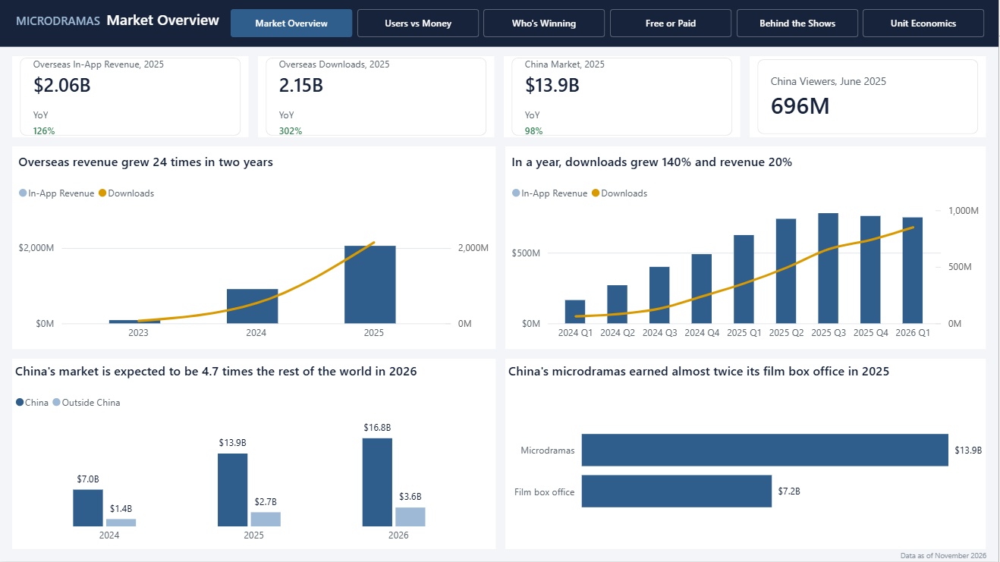
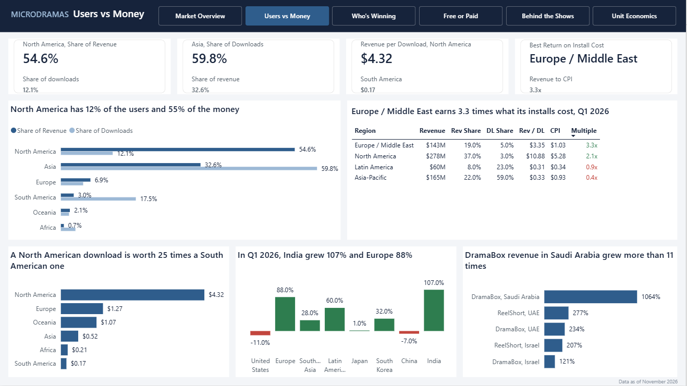
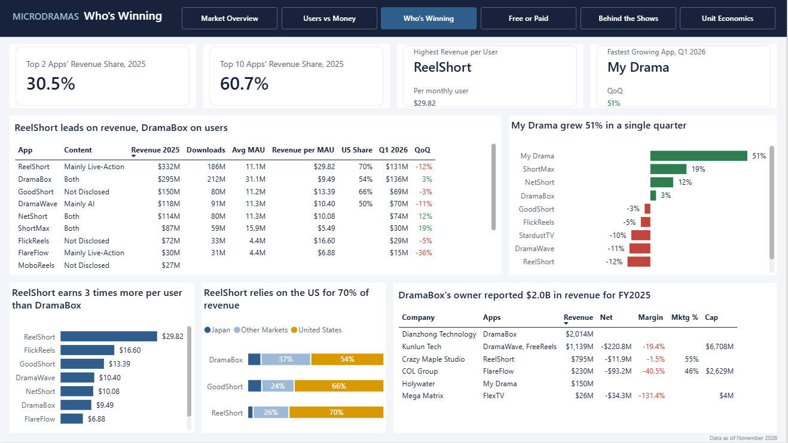
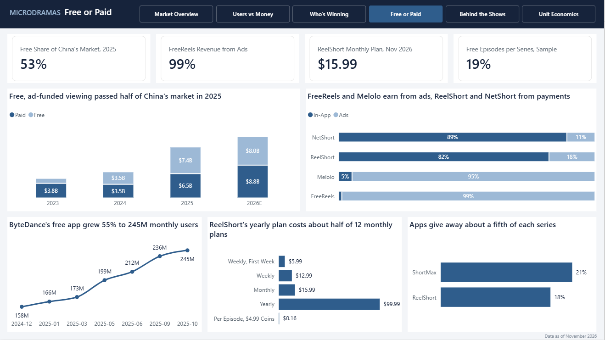
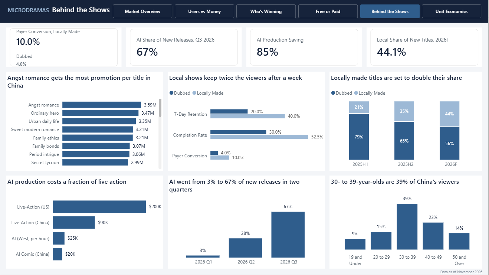
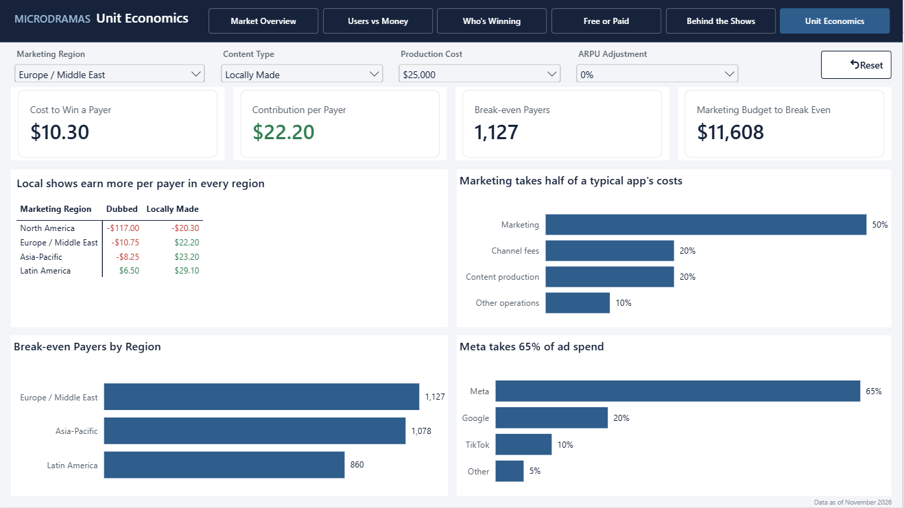

# Microdramas: Beyond the Hype

Everyone has seen the one-minute drama clips. Fewer people have looked at the money behind them.

Microdramas are short, vertical drama series watched on phones, in episodes of one to two minutes. The format started in China, spread worldwide within two years, and is now a multi-billion-dollar market. Most coverage stops at that headline: the market is booming.

What caught my attention was the speed of it. Overseas revenue went from $87M in 2023 to $2.06B in 2025, 24 times in two years, and the market outside China is expected to reach $3.6B in 2026. I wanted to know where that growth comes from, where the money is made, and where the next opportunities are.

The answers were scattered across separate industry reports, several of them published only in Chinese, and none answers these questions on its own. So I brought them together in one Power BI model and built the report around six questions:

1. **Market Overview:** how big is the market, and how fast is it growing?
2. **Users vs Money:** where are the users, and where is the money?
3. **Who's Winning:** which apps are growing fastest, and who earns most per user?
4. **Free or Paid:** do viewers pay, or do ads pay for them?
5. **Behind the Shows:** what gets made, what does it cost, and how fast is AI taking over?
6. **Unit Economics:** how many paying viewers does a single series need to break even?

## Key findings

- **The market is growing fast.** Overseas revenue grew 24 times between 2023 and 2025, and downloads reached 850M in Q1 2026, up 140% in a year.
- **North America pays the most.** It brings 55% of overseas revenue from 12% of downloads, and a North American download earns $4.32.
- **Europe and the Middle East offer the best return.** Revenue there is 3.3 times what installs cost, and DramaBox revenue in Saudi Arabia grew more than 11 times in 2025.
- **China shows how big this can get.** China's microdramas reached $13.9B in 2025, almost twice the country's film box office.
- **New players are breaking through.** My Drama grew 51% in a single quarter, ShortMax 19% and NetShort 12%.
- **Free viewing reaches huge audiences.** ByteDance's free app grew 55% to 245M monthly users, and free, ad-funded viewing passed half of China's market.
- **AI is opening the door.** AI-made titles went from 3% to 67% of new overseas releases in two quarters, at about $25K per hour against $200K for a US live-action series.
- **Local content wins viewers.** On industry benchmarks, locally made shows keep twice as many viewers after a week, and their share of new titles is set to double by 2026.
- **Break-even is within reach.** On industry benchmarks, a $25K AI series needs about 1,100 paying viewers to recover its cost.

## Report pages

| Page | What it shows |
|---|---|
|  | **Market Overview:** overseas revenue and downloads by year and quarter, China against the rest of the world, and microdramas against China's film box office. |
|  | **Users vs Money:** download and revenue share by continent, revenue per download, return on install cost by region, growth by market and Middle East growth. |
|  | **Who's Winning:** app scorecard, quarter-on-quarter growth, revenue per user, revenue by country and operator financials. |
|  | **Free or Paid:** China's paid and free market, in-app vs ad revenue by app, ByteDance's free app, plan prices and free episodes. |
|  | **Behind the Shows:** genre promotion, locally made vs dubbed content, the rise of locally made titles, production cost by format, AI share of new releases and viewers by age. |
|  | **Unit Economics:** an interactive scenario. Choose a region, content type, production cost and spending adjustment to see the cost to win a payer, contribution per payer, break-even payers and the marketing budget needed. |

## How it is built

The whole report is stored as code in the Power BI Project (PBIP) format, so every table, measure and visual can be reviewed in Git.

- **Semantic model (TMDL):** a star schema with 34 tables (a marked Date table, 4 dimensions, 26 fact tables, 2 what-if parameter tables and a measures table), 118 DAX measures in numbered display folders, and 12 single-direction relationships.
- **Report (PBIR):** 6 pages and 112 native visuals, a custom theme, field-based conditional formatting, button navigation between pages, and a bookmark that resets the scenario page.
- **Version-controlled:** the model and report are stored as text files, so every measure, layout and formatting decision can be reviewed and changed consistently across pages.

## Open the report

1. Install a recent version of [Power BI Desktop](https://powerbi.microsoft.com/desktop/) (tested on version 2.159).
2. Clone this repository and open `microdrama-market-study.pbip`.
3. Go to **Home > Transform data > Edit parameters** and set **DataFolder** to the full path of the `data/gold/` folder, including the trailing backslash.
4. Select **Refresh**.

While editing in Power BI Desktop, use Ctrl+click to activate the page buttons and the Reset button.

## Author

Halima Bejaoui · [LinkedIn](https://www.linkedin.com/in/bejaoui-halima)
